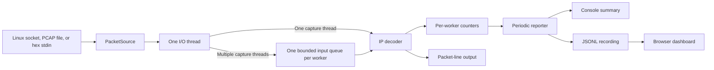

# C++ Sniffer

[Play the demo locally](demo/index.html) · [View the architecture](#architecture) ·
[Reproduce the queue benchmark](#per-worker-queue-capacity) · [Build and capture](#build-and-capture)

C++ Sniffer captures IPv4 and IPv6 packets on one Linux network interface and
reports throughput and packet counts about once per second. Use
`--packet-lines` to inspect addresses, IP protocols, and packet lengths. It recognizes TCP, UDP, ICMP, ICMPv6, IGMP, SCTP, and ESP.
Unmapped protocol numbers appear as `Unknown`. For IPv6 it follows common
extension headers when present in the captured packet.

## What problem does it solve?

When network traffic spikes, an overall bandwidth number tells you how big
the spike was. This tool helps locate the spike in time and shows which IP
protocols contributed the most packets. On Linux, you can record an interval
summary from an interface you control, or process an existing PCAP for offline
inspection. Load the saved metrics into the dashboard to review throughput
and protocol counts over time.

Open the demo and try **Jump to TCP burst** and **Jump to UDP burst**. The
synthetic replay walks through two examples without capture privileges.
**Compare worker queue sizes** shows the measured trade-off between
processing more packets per second and keeping handoff latency low.

## Build and capture

From the repository root, enter the project directory and build with GNU
Make and a C++14 compiler on Linux. For live capture, use an interface
you are authorized to monitor. The live backend requires `CAP_NET_RAW`.

```sh
cd projects/packet-sniffer
make
sudo ./cpp-sniffer lo
```

Run `ping -c 3 127.0.0.1` in a second terminal to generate loopback
traffic. Press Ctrl+C in the sniffer terminal to stop capture.

### Console output

By default, the sniffer prints a summary about once per second. Each line
shows elapsed time, packets per second, decoded IP megabits per second,
the running packet count, and per-protocol counts for that interval. The final line adds the session-average IP
throughput. Rates include decoded IP headers and payloads.

```text
1.00 s | 6.00 packets/s | 0.00 Mb/s IP | 6 packets total | protocols=ICMP(1)=6
```

| Mode | What you see in the terminal |
| --- | --- |
| Default | Periodic throughput and packet counts, plus a final summary. |
| `--packet-lines` | One line per decoded IP packet with its addresses, protocol, and length. |
| `--stats` | Adds a detailed session summary on stderr when capture ends. |
| `--metrics-only` | JSON interval summaries on stdout for dashboard import. A short replay may only produce the final line. |

Run this example without capture privileges to see the final summary
immediately.

```sh
printf '450000140000000040110000c0000201c6336402\n' | ./cpp-sniffer --hex-stdin
```

Adding `> capture.jsonl` to a metrics-only command saves its stdout for
dashboard import. If you also pass `--stats`, the final session summary
still appears on stderr.

## Unit tests

Install the GoogleTest and GoogleMock development packages (for example,
`libgtest-dev` and `libgmock-dev` on Ubuntu 24.04). The test harness uses C++14
for compatibility with GoogleTest 1.14. It links against the same C++14 capture loop, decoder, and formatter used by
the CLI. GoogleMock supplies deterministic packets through the `PacketSource`
interface. Run the tests without capture privileges.

```sh
make test
```

## Project layout

| Directory | Responsibility |
| --- | --- |
| `include/sniffer/` | Packet source interface and decoder metadata |
| `src/capture/` | Shared capture loops |
| `src/capture/common/` | Ethernet and VLAN parsing shared by live raw capture and PCAP replay |
| `src/capture/pipeline/` | Bounded queues, batched packet output, and timed metrics |
| `src/capture/linux_socket/` | Cooked and raw Linux packet sockets |
| `src/capture/hex_replay/` | Userspace replay from a hex input stream |
| `src/capture/pcap_replay/` | Offline Ethernet PCAP replay |
| `include/sniffer/capture/` | Backend headers grouped by backend |
| `src/decode/` | IPv4 and IPv6 header validation and metadata extraction |
| `src/output/` | Protocol names and human-readable packet summaries |
| `tests/` | Synthetic packet fixtures and mocked capture loop tests |

## Architecture



1. **Read and normalize.** [main.cpp](src/main.cpp) loads CLI or config
   settings and selects a [packet source](include/sniffer/packet_source.h).
   Raw Linux capture and Ethernet PCAP replay use the shared Ethernet/VLAN
   parser to extract an EtherType and network-layer bytes. The rest of the
   pipeline receives the same packet structure from every backend.
2. **Decode.** One I/O thread reads packets. With `cpus = 1`, it also
   decodes them. With `cpus = 4`, it distributes packets round-robin to
   three decode workers, each with its own bounded queue. The [IP decoder](src/decode/ip_decoder.cpp)
   validates IPv4 or IPv6 headers and extracts source, destination, IP
   protocol, and packet length. The reader waits if the selected worker’s queue fills.
3. **Report.** In the default console and JSON modes, each worker counts
   decoded packets, skipped packets, IP bytes, and protocols locally.
   Workers publish in batches, when their input queue empties, and at exit.
   The [reporter](src/capture/pipeline/timed_metrics.h) merges those counts
   about once per second and issues a final summary. Redirect
   `--metrics-only` output to a JSONL file to play it in the browser.
4. **Inspect individual packets.** With `--packet-lines`, a single capture
   thread decodes and prints inline. With multiple capture threads,
   workers batch results for a [dedicated writer](src/capture/pipeline/packet_output.cpp).
   The writer prints each record, and output can differ from capture order.

The periodic reporter and threaded packet writer each use a separate
thread outside the configured capture thread count. The pipeline owners
close queues or signal completion and join their threads during shutdown.
The browser dashboard reads a saved metrics file or its bundled synthetic
trace.

## Capture backends

| Command | Input |
| --- | --- |
| `./cpp-sniffer INTERFACE` | Linux `AF_PACKET/SOCK_DGRAM` with the link-layer header stripped by the kernel |
| `./cpp-sniffer --raw INTERFACE` | Linux `AF_PACKET/SOCK_RAW` on Ethernet or loopback, with Ethernet II and VLAN headers stripped by the adapter |
| `./cpp-sniffer --hex-stdin` | Userspace replay of IPv4 or IPv6 bytes from standard input, one contiguous hex string per line |
| `./cpp-sniffer --pcap FILE` | Offline replay from classic Ethernet PCAP 2.4 |

Both live socket modes require `CAP_NET_RAW`. Hex and PCAP replay need no capture
privileges. For example, replay an IPv4 header with protocol number 17.

```sh
printf '450000140000000040110000c0000201c6336402\n' | ./cpp-sniffer --hex-stdin
```

To add a backend, implement `PacketSource::next` to supply the host-order
EtherType and bytes beginning at the network-layer header. Return `false` at
end of input. Place the adapter in its own directory under `src/capture/` with headers
under `include/sniffer/capture/`. Add its objects to the Makefile and select
it in `src/main.cpp`.
The capture loop, decoder, and sink accept the same packet contract for each
backend. Adapter tests can use input streams or in-memory frames, and pipeline
tests can substitute any of the interfaces with GoogleMock.

## Threaded capture

Put `--threaded` before any backend selection, for example
`./cpp-sniffer --threaded --hex-stdin < packets.hex`. The capture thread
routes packets round-robin to one bounded FIFO queue per worker. Workers
decode in parallel. With `--packet-lines`, each worker hands batches
of up to 16 results to a dedicated writer. The writer owns the output stream
and flushes outstanding batches at end of input. Output can differ from receive
order. The periodic summary modes merge counts across workers.
When the selected worker’s queue fills, capture waits for space there. At end of input,
the workers drain queued packets before the program exits.

If output fails while the input is blocked in a read, shutdown waits for that
read to return. For live capture, Ctrl+C stops the process.

## Configuration file

Pass `--config FILE` by itself to load capture settings from a file.
Use one `key = value` per line. Blank lines and lines beginning with `#`
are ignored.

| Key | Accepted values |
| --- | --- |
| `backend` | `cooked` (default), `raw`, `hex-stdin`, or `pcap` |
| `interface` | A Linux interface name such as `lo`. Required for `cooked` and `raw`. Omit for replay. |
| `pcap_file` | Path to a capture file, relative to the working directory or absolute. Required for `pcap`. |
| `stats` | `true` or `false` (default) |
| `metrics_only` | `true` emits periodic JSON metrics. Defaults to `false`. |
| `packet_lines` | `true` prints one line per packet. Defaults to `false`. Enable only one of `packet_lines` and `metrics_only`. |
| `threaded` | `true` uses two total threads and `false` (default) uses one, unless `cpus` is set. |
| `cpus` | Total capture threads, including the receiver. Use a positive integer or `auto` for all logical CPUs available through the process affinity mask. |
| `queue_capacity` | Maximum queued packets per decode worker. Use a positive integer. Defaults to 64 and applies when decoding uses separate workers. |

Run the included threaded replay example.

```sh
printf '450000140000000040110000c0000201c6336402\n' | ./cpp-sniffer --config config/example.conf
```

## Offline replay and capture metrics

Generate a small synthetic Ethernet capture and replay it without capture
privileges.

```sh
python3 benchmarks/replay.py --packets 4 --write-pcap /tmp/sample.pcap
./cpp-sniffer --threaded --stats --pcap /tmp/sample.pcap
```

`--stats` writes a summary to standard error. It reports packets delivered by
the backend, packets decoded or skipped by the decoder, packets left unprocessed
if output stops early, the highest occupancy of any worker queue, and the sum of full-queue waits.
Each worker queue holds up to 64 packets by default. During live capture with stats enabled, press Ctrl+C to drain
the queues and report Linux packet-socket kernel drops alongside the pipeline
counters.

## Replay benchmark

Run `make` and then `python3 benchmarks/replay.py`. The benchmark alternates
single-threaded and threaded runs against the same generated capture. It
includes parsing and packet summary formatting, with output redirected to
`/dev/null`. CPU usage is process CPU time divided by elapsed wall time.

| Mode | Packets/s | CPU usage | Queue peak | Queue waits |
| --- | ---: | ---: | ---: | ---: |
| Single-threaded | 65,161 | 99.7% | 0 | 0 |
| Threaded | 51,639 | 135.4% | 64 | 19,451 |

Historical medians from five runs of 20,000 synthetic IPv4/IPv6 Ethernet packets
from the earlier single-worker implementation, measured on
an Intel Core i7-6700HQ with the default optimized build. The queue filled
and the producer frequently waited for the decode-and-output worker. The
threaded mode used more CPU and achieved about 21% lower throughput on
this replay workload. Live capture performance depends on the interface,
packet mix, and output destination.

### Worker scaling with Google Benchmark

Set `cpus` in the config to choose the total thread count. For example, this
uses one receiving thread and three decode workers. With `cpus = 1`, the
receiver also decodes and writes. The setting controls thread count without
pinning threads to individual CPUs.

```ini
backend = hex-stdin
cpus = 4
stats = true
```

Install Google Benchmark development files (for example, `libbenchmark-dev`
on Ubuntu), then run `make benchmark`. The benchmark tests one thread,
power-of-two thread counts, and all available logical CPUs. It sends 16,384
in-memory packets through the real capture pipeline per iteration and uses a
counting sink. The timing includes worker startup and shutdown. Google
Benchmark reports packet throughput, wall time, process CPU time, and average
full-queue waits. The Python replay benchmark also includes file I/O and text
formatting.

```sh
make sniffer-benchmark
./sniffer-benchmark --benchmark_filter='capture/cpus:4/'
```

### Data rate and shareable performance report

`--stats` reports `decoded_ip_bytes`, `elapsed_seconds`,
`packets_per_second`, `ip_bytes_per_second`, and `ip_bits_per_second`.
These are session averages. The byte count includes decoded IP headers and
payloads. Ethernet headers and frames skipped by the decoder are excluded.

Open the [standalone performance report](docs/benchmark-report.html) in a
browser. It shows throughput in packets/s and Mb/s by thread count and
explains the synthetic workload. The HTML can be shared as a file or
published on a static host.

Regenerate the report from your own measurements.

```sh
make sniffer-benchmark
./sniffer-benchmark --benchmark_repetitions=3 --benchmark_out=rates.json --benchmark_out_format=json
python3 benchmarks/render_report.py rates.json docs/benchmark-report.html
```

## Local replay dashboard

Open [demo/index.html](demo/index.html) in a browser and press **Play**.
The timeline shows decoded IP Mb/s, packets per second, and packet counts by
IP protocol for the selected interval. **Jump to peak rate** finds the
highest-throughput interval in either the sample or an imported recording. Pause, scrub, or change speed to explore the 48-second
synthetic trace. The included trace and dashboard work offline in a modern
browser, including on Windows.

To regenerate the trace, build the C++ sniffer on Linux and run
`python3 demo/generate_trace.py`. The generator sends synthetic IPv4 and
IPv6 headers with payload bytes through the C++ hex replay backend and
groups decoded packets into one-second bins for the dashboard.

The application panel shows HTTP requests over TCP and DNS and NTP queries
over UDP. Labels come from the trace generator's fixtures. The C++ sniffer
decodes the IP protocol and length for each packet. Application counts are
subsets of the IP protocol counts for the same replay second.

### Share on GitHub Pages

For a dedicated demo repository, put `demo/index.html`, `demo/style.css`,
`demo/replay.js`, and `demo/trace.js` together at the repository root.
In **Settings → Pages**, select **Deploy from a branch**, then choose the
default branch and **/(root)**. Share the URL displayed in Pages settings.
The published demo runs entirely in the browser using the bundled synthetic
trace. For an existing repository, you can put the same four files in its
root-level `docs/` directory and select **/docs** as the publishing source.

[GitHub Pages publishing instructions](https://docs.github.com/en/pages/getting-started-with-github-pages/configuring-a-publishing-source-for-your-github-pages-site)

### Record per-worker metrics for the dashboard

Use `--metrics-only` (or `metrics_only = true` in the config) to write
newline-delimited JSON to stdout. A timer merges per-worker counters about
once a second and emits a final interval on exit. Each interval records its
actual duration, decoded IP bytes, decoded and skipped packet counts, and a
count per IP protocol number. The timer uses one thread in addition to the
configured capture and decoder threads.

```sh
./cpp-sniffer --threaded --metrics-only --pcap sample.pcap > capture.jsonl
```

Open `demo/index.html` and select `capture.jsonl` under **Open metrics file**. The browser reads the saved file locally. The bundled sample
trace is still available from the same page.


### CI and GitHub Pages

The repository-level **Packet Sniffer** GitHub Actions workflow builds the
C++14 CLI, tests, and benchmark on Ubuntu, checks packet counts and bytes
through PCAP replay, and verifies the bundled demo trace. Run the PCAP
check locally with `make` followed by `python3 tests/check_pcap_replay.py`.

To publish using the workflow, place it on the repository's default
branch. A maintainer can select **GitHub Actions** in **Settings → Pages**,
then run **Packet Sniffer** from the **Actions** tab with **Publish the
demo to GitHub Pages** checked. The deployment job shows the resulting URL.
[GitHub Pages workflow setup](https://docs.github.com/en/pages/getting-started-with-github-pages/using-custom-workflows-with-github-pages)

### Metrics-only vs per-packet output

Both modes decoded the same 16,384 synthetic 20-byte IPv4 packets per
iteration. Per-packet mode formatted each decoded packet through
`StreamPacketSink` into a discard stream. Metrics-only mode used the
production worker counters and timer with an in-memory callback. The
benchmark included thread startup and shutdown.

One I/O thread reads packets. With `cpus = 1`, it also decodes packets inline.
With `cpus = 4`, it hands packets off to three decode workers. Threaded
per-packet output adds a writer thread. Metrics-only mode adds a reporting
thread. The table counts the input thread and decode workers.

| I/O threads | Decode workers | Per-packet packets/s | Per-packet IP Mb/s | Metrics-only packets/s | Metrics-only IP Mb/s |
| ---: | ---: | ---: | ---: | ---: | ---: |
| 1 | 0 (inline decode) | 1,517,829 | 242.85 | 1,561,408 | 249.83 |
| 1 | 1 | 587,425 | 93.99 | 611,290 | 97.81 |
| 1 | 3 | 1,283,818 | 205.41 | 1,031,608 | 165.06 |
| 1 | 7 | 634,679 | 101.55 | 442,812 | 70.85 |

These are medians from three runs on an Intel Core i7-6700HQ. This short
replay includes the extra writer or timer where applicable. It omits
terminal, disk, and socket I/O, so the timings reflect the synthetic
workload and host conditions.

On Ubuntu, install the Google Benchmark development package before building.

```sh
sudo apt install libbenchmark-dev
make sniffer-benchmark
./sniffer-benchmark --benchmark_filter='capture_(per_packet|metrics_only)/' \
  --benchmark_min_time=0.1s --benchmark_repetitions=3
```

### Per-worker queue capacity

Set `queue_capacity` in the config to tune how many packets each decode
worker can have waiting. For example, this uses one reader and three
workers, with room for up to 768 queued packets across the workers.

```ini
backend = pcap
pcap_file = sample.pcap
cpus = 4
queue_capacity = 256
metrics_only = true
```

Google Benchmark compared capacities with one reader and three workers
in metrics-only mode. Each iteration replayed 16,384 in-memory IPv4
packets. Full-queue waits are per iteration. A separate instrumented run
measured handoff latency from when the reader produced a packet to when
a worker started decoding it, including any wait for queue space.

| Packets per worker queue | Packets/s | Full-queue waits | p95 handoff latency |
| ---: | ---: | ---: | ---: |
| 64 | 900,326 | 34.8 | 39.3 µs |
| 256 | 1,091,025 | 4.2 | 123.9 µs |
| 1,024 | 1,129,427 | 0.2 | 127.6 µs |

Values are medians across five benchmark repetitions on an Intel Core
i7-6700HQ. The larger queues reduced reader waits and improved throughput
on this workload, while the 64-packet queue had the lowest p95 latency.
The default remains 64. Set 256 when replay throughput matters more
than handoff latency on a similar workload.

```sh
make sniffer-benchmark
./sniffer-benchmark --benchmark_filter='capture_queue_capacity/|queue_handoff_latency/' \
  --benchmark_min_time=0.15s --benchmark_repetitions=5
```
